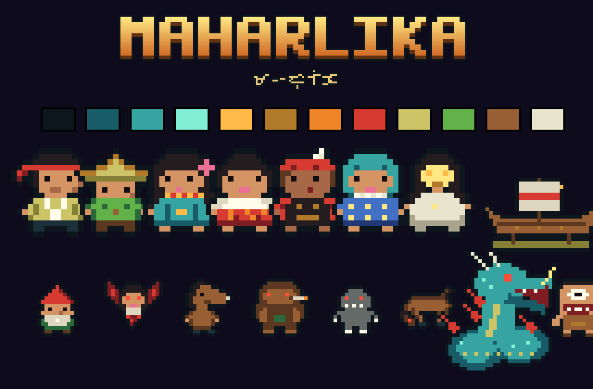
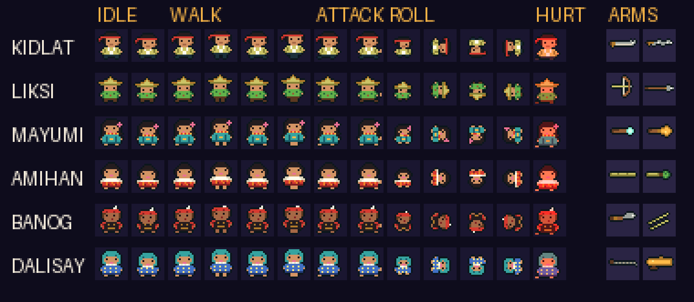

# MAHARLIKA: Ang Gabi ng Bakunawa

A pixel-art action roguelike for Android, built with React Native (Expo), set in a
Philippines that was never colonized.

> In 1521 Lapulapu turned back Magellan at Mactan, and in this history no one ever came back.
> Five centuries later the free islands of **Maharlika** face the **Bakunawa**, the sea serpent
> of Visayan myth that swallowed six of Bathala's seven moons and has risen for the last one.
> Haliya, the masked Bicolano goddess of moonlight, calls four maharlika to sail the islands and
> hold the serpent back while the people beat their gongs to drive it off.



The myths, gods and creatures come from documented Philippine folklore (Visayan, Bicolano and
Tagalog). The story bible in [`docs/STORY.md`](docs/STORY.md) lists every element and whether
it is folklore, history or invented for the game.

## How it plays

- **Islands, not rooms:** each stage is an island in the sea. You walk on land, shots fly over water.
  Clear the island, visit its **dambana** (shrine), then board the **balangay** to sail on.
- **Blessings of the gods:** each dambana offers three of eight Tagalog deities (Apolaki, Mayari,
  Tala, Anitun Tabu, Dumakulem, Lakapati, Aman Sinaya, Lakan Bakod). Pick one; they stack for the run.
- **Two weapons per hero, picked on the select screen:** kampilan or kris (melee, both cut enemy shots),
  pana or bangkaw (bow, or a piercing thrown spear), agimat rod or lingganay (piercing spirit orbs, or a
  three-way fan of bell chimes), sumpit or barang (poison darts, or homing spirit beetles).
- **Eight folklore creatures** besides the Bakunawa, each with its own trick: duwende, manananggal,
  tikbalang, kapre, the **tiyanak** (cries like a baby until you come close), the **sigbin** (unseen
  until it is near), the **santelmo** (fire that floats over water) and the **bungisngis** (a laughing
  giant whose slam sends out a ring of shots).
- **Dodge roll** for everyone; **skills charge with light** from fighting and catching fireflies.
- **Health beads and amulets:** amulets (anting-anting) absorb hits and recharge.

| Hero | From | Weapons | Skill |
|---|---|---|---|
| **Kidlat** | Mactan, maharlika warrior | Kampilan / Kris | Bagyo: blade whirl that clears shots |
| **Liksi** | Butuan, navigator | Pana / Bangkaw | Ulan ng Pana: arrow storm |
| **Mayumi** | Panay, babaylan | Agimat rod / Lingganay | Anito Ring: spirit orbs |
| **Amihan** | Siquijor, mananambal | Sumpit / Barang | Tambal: heal and restore amulets |

Every guardian is fully animated: idle breathing, a 4-step walk, a two-beat attack, a 4-frame
dodge roll and a hurt recoil, with footstep dust and hit sparks.



The home screen menu is in Filipino with the English beside each item (Laro · Play, Simula · Prologue,
Alamat · Legends, Paano Maglaro · How to Play) and a one-line hint on every option and a How to Play guide covering the controls and the goal of a run.

Route: Port of Tondo → Punso Fields → Siquijor → Mount Banahaw → Ibalong Forests → Shore of Albay
(the Bakunawa). Illustrated prologue and ending, a dialogue before the boss, an epilogue per hero,
and the **Alamat** (Legends) codex (Maharlika · Nilalang · Mga Diyos · Daigdig: heroes, creatures, gods, world) with sources.

## Controls

| Touch | Action |
|---|---|
| Left half | Floating joystick |
| Crossed blades (big diamond) | Hold to attack (auto-aims) |
| Wind (small diamond) | Dodge roll |
| Sun | Skill, when your light is full |
| Cards at a dambana | Choose a blessing |

Web build: `WASD` move, `Space` attack, `Shift` dodge, `K` skill, `1-3` choose a blessing, `Esc` pause.
On the home screen, `Enter` plays and `H` opens How to Play.

## Running it

```bash
npm install
npx expo start              # scan the QR code with Expo Go on Android
npx eas-cli@latest build -p android --profile preview   # installable APK
```

Single-file web build:

```bash
npx expo export --platform web --output-dir dist
python3 tools/build_web_single.py dist maharlika.html
```

## Assets

Everything is drawn in [`tools/generate_assets.py`](tools/generate_assets.py) as pixel maps or
small procedural routines (Baybayin is rendered from Noto Sans Tagalog). Run
`python3 tools/generate_assets.py` (needs Pillow and `npm install`) to regenerate:

- heroes in five poses (idle, walk, attack, roll, hurt), creatures, the Bakunawa, Haliya, eight
  weapons, shots, the kampilan slash, footstep dust and hit sparks; `assets/brand/animation_sheet.png`
- island maps (sea, surf, sand, themed ground and props such as punso, banana, balete, rocks,
  bronze lamp posts) with collision grids in `src/game/rooms.json`
- balangay, dambana, agung; HUD medallion, bead pips, eight deity emblems, touch controls
- title (Mayon, the eclipse, the Bakunawa and the fleet), select, defeat, dawn screens; logo
  and Baybayin logo; 8 story panels; 6 dialogue portraits; brand sheet; app icons

## Project layout

```
App.tsx                    screen flow: title → story → select → game → ending → result; codex
src/game/data.ts           heroes, weapons, creatures, the gods' blessings
src/game/story.ts          all story text, bios with sources, island names in Baybayin
src/game/engine.ts         simulation: islands, melee and ranged combat, dodge, light, blessings, AI
src/screens/               Title, Story, Codex, Select, Game, Result
src/ui.tsx                 palette, pixel and Baybayin text, buttons, panels
tools/generate_assets.py   all art
docs/STORY.md              story bible and sources
```
